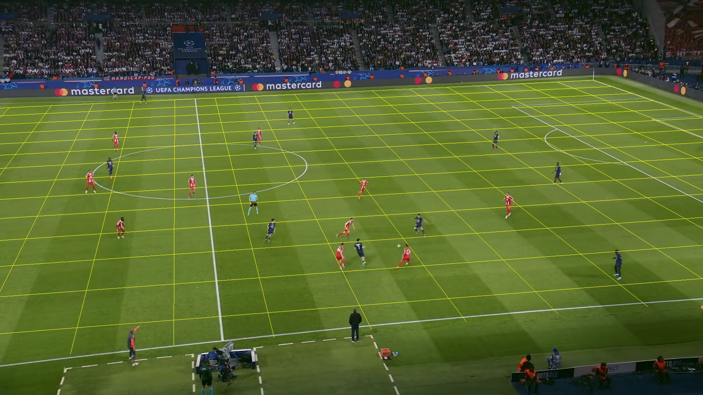
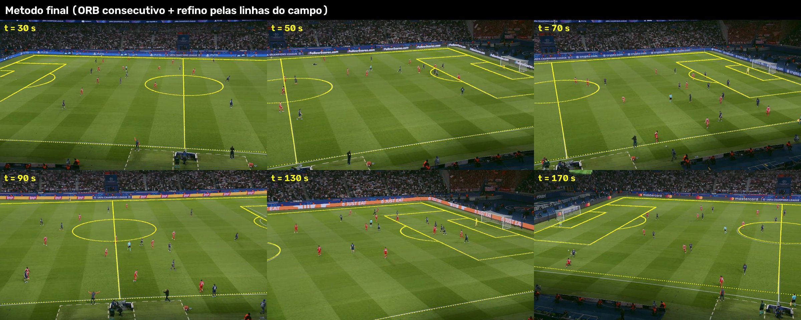
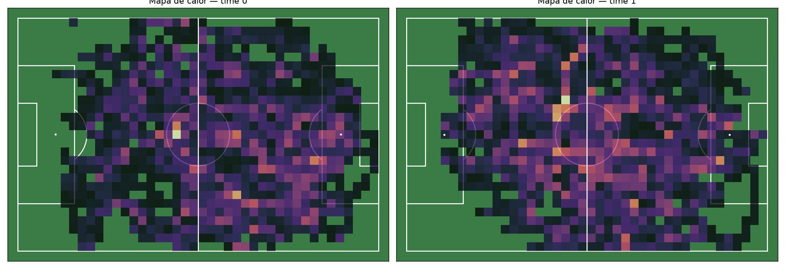
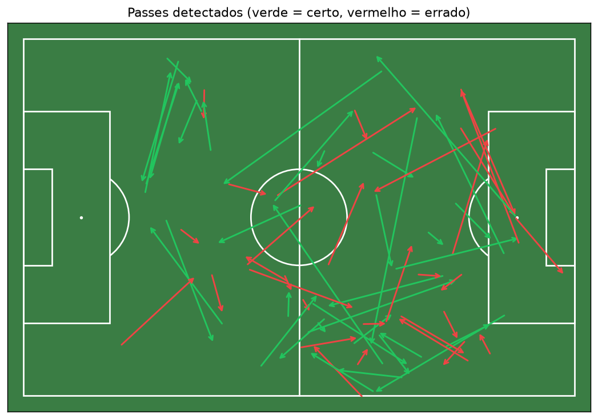
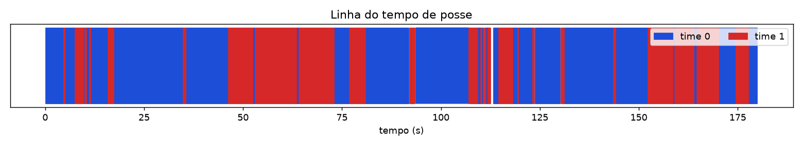
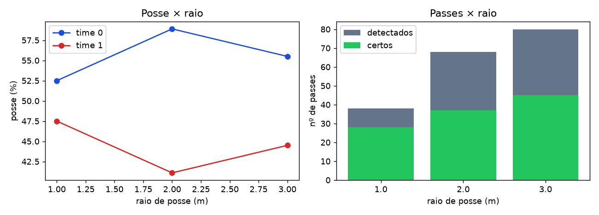
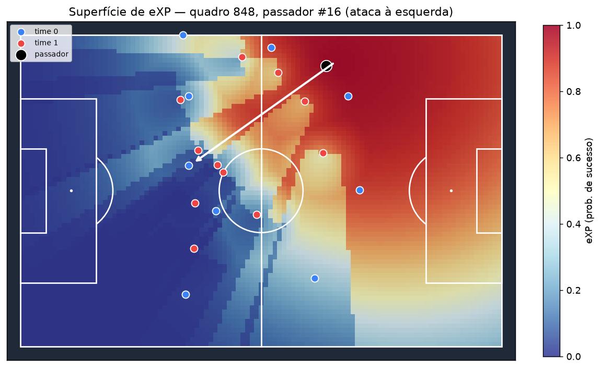
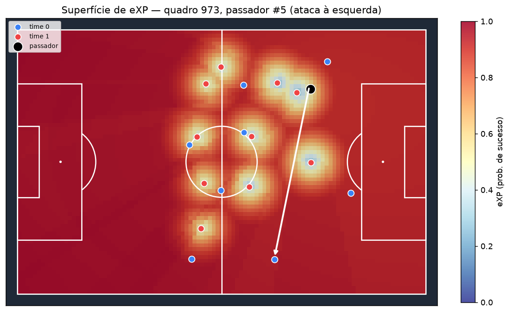
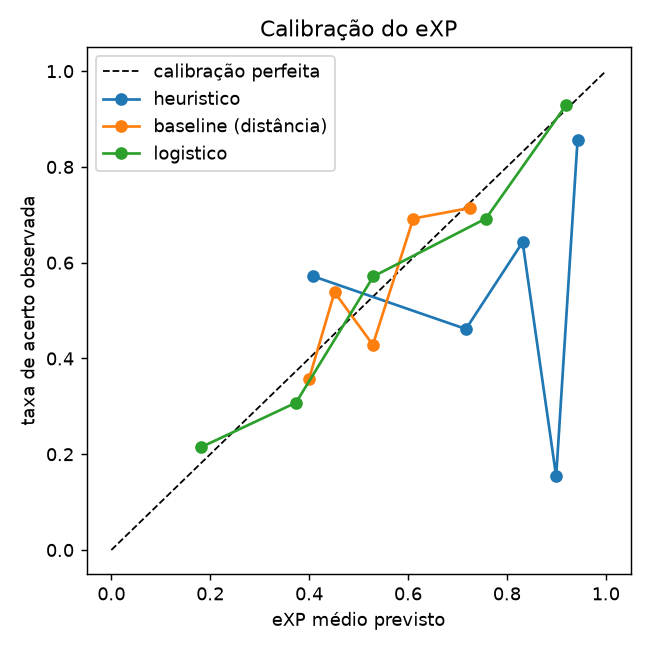

# Prática 3 — Futebol Analytics com YOLO · PSG × Bayern

**Visão Computacional · CESAR School · 2026.2** — detecção, rastreamento, projeção no campo e métricas de jogo (posse, passes, eXP) a partir de um trecho de transmissão.

**Grupo:** Helder Cordeiro de Barros Filho · Lucas Rafael Gomes Maia da Silva · José Kevin Sales da Silva · Lucas Jerônimo Mendes · Felipe Salustiano Moreira
**Apresentação (09/11/2026):** Lucas Rafael

> **Sobre os números deste README:** todas as tabelas entre marcadores `<!-- AUTO:... -->` são geradas por `gerar_readme_numeros.py` a partir dos arquivos em `saidas/psg_bayern/`, e `python gerar_readme_numeros.py --saida saidas/psg_bayern --verificar` confere a consistência README × arquivos. Os números citados no texto das respostas foram conferidos contra essas tabelas e arquivos. Alguns foram calculados a partir dos arquivos durante a análise, mas não ficam salvos num arquivo próprio (ex.: novos IDs por minuto na Q3.1, extremos de posição por time na Q5.4, passes com time errado na Q5.3). Outros vêm das execuções e testes e não têm arquivo (tempos de processamento na Q1.2, testes de ORB/SIFT na Q4.3, testes com k = 3 e k = 4 na Q3.3).

---

## 1. Vídeo (fora do repositório)

| Item | Valor |
|---|---|
| Jogo | Paris Saint-Germain × Bayern de Munique — câmera tática |
| URL | https://www.youtube.com/watch?v=fg3DmFxMWZ4 |
| Intervalo usado | **18:20 – 21:20** (3 min) |
| Arquivo local | `videos/Psg Bayern - camara tactica_clip.mp4` (ignorado pelo git) |
| Onde obter | Google Drive do grupo: `https://drive.google.com/drive/folders/1kH0DHNEouE_V021al4N0HwpulaLJAXrD` |

O vídeo foi baixado e cortado fora do pipeline (não é versionado). Propriedades medidas por `extrair_frame0.py`:

<!-- AUTO:video -->
| Resolução | FPS | Quadros | Duração | Cortes de câmera detectados |
|---|---:|---:|---:|---|
| 1920×1080 | 25 | 4500 | 180.0 s | nenhum |
<!-- /AUTO:video -->

## 2. Pipeline

```
vídeo (3 min, 1080p25)
  │  extrair_frame0.py ─────────────► frame0.jpg, video_info.json (validação + cortes de cena)
  │  comparar_yolo.py ──────────────► comparar_yolo.csv  (n/s/m × imgsz × conf da bola, 30 s)
  ▼
detectar_rastrear.py  (YOLO COCO pessoa+bola · ByteTrack · filtro de gramado · K-Means de cor)
  │                   ─────────────► tracks.csv, meta.json, rastreado.mp4 (fora do git)
  ├─ classificador_times.py (times por track: k = 2 + regra do árbitro) ► times_por_track.csv
  ├─ ferramentas/clicar_marcos.py (H0) + ferramentas/calibrar_ancoras.py (10 âncoras)
  │  homografia.py pares (ORB consecutivo) · refinar (ICP ponto-à-reta nas linhas)
  │                                  ──────────────► calibracao*.json, camera_refinada.npy
  ├─ bola_kalman.py  (filtro de campo + Kalman + gating) ─► bola.csv, bola_resumo.json
  └─ homografia.py projetar ─────────────────────────► tracks_campo.csv, bola_campo.csv
  ▼
metricas.py  (posse < 2 m, distância/velocidade, passes, mapas) ──► metricas_times.json,
  │                                                                 metricas_jogadores.csv, passes.csv
  ├─ sensibilidade_posse.py (raio 1/2/3 m) ─────────► sensibilidade_raio.csv
  ├─ ferramentas/anotar_passes.py + validar_passes.py ► passes_anotados.csv, validacao_passes.json
  └─ xpass.py  (baseline · heurístico · logístico · superfície · what-if · PAx) ► resultados_xp.csv
  ▼
gerar_readme_numeros.py (tabelas do README) · gerar_clipe.py (clipe da apresentação) · slides/
```

Ponto de projeção: **pé do jogador** (centro da base do bbox); a posição no campo é `[x, y, 1]ᵀ ~ Hₜ · [u, v, 1]ᵀ`, com `Hₜ = refino_linhas(Hₜ₋₁ · Mₜ)` (Mₜ = homografia ORB do quadro t para o t−1) e `H₀` da calibração manual, em metros, campo 105 × 68 m (origem no canto superior esquerdo visto da câmera).

## 3. Como rodar (Windows / PowerShell)

```powershell
python -m venv .venv; .\.venv\Scripts\Activate.ps1
pip install torch==2.11.0 torchvision==0.26.0 --index-url https://download.pytorch.org/whl/cu128
pip install -r requirements.txt
python -c "import torch; print(torch.cuda.is_available(), torch.cuda.get_device_name(0))"

$V = "videos/Psg Bayern - camara tactica_clip.mp4"; $S = "saidas/psg_bayern"

# Etapa 1 — validação do vídeo
python extrair_frame0.py --video $V --saida $S --cortes
# Etapa 2 — comparação de modelos e detecção/rastreamento
python comparar_yolo.py --video $V --saida $S --modelos yolov8n.pt yolov8s.pt yolov8m.pt yolo11m.pt yolo11l.pt --imgsz 640 1280
python detectar_rastrear.py --video $V --saida $S --modelo yolov8m.pt --imgsz 1280 --k 3
# Etapa 3 — bola e homografia (clicar marcos abre uma janela)
python classificador_times.py --video $V --saida $S          # times por track (pós-processamento)
python ferramentas/clicar_marcos.py --saida $S                 # H0 no frame0 (janela)
python ferramentas/calibrar_ancoras.py --video $V --saida $S   # âncoras a cada 20 s (janela)
python homografia.py camera --saida $S --mascara gramado       # método do código de apoio: só para comparação (deriva)
python homografia.py pares --saida $S                          # ORB entre quadros consecutivos
python homografia.py refinar --saida $S                        # validação independente nas âncoras
Copy-Item $S/camera_validacao_ancoras.csv $S/camera_validacao_independente.csv
Copy-Item $S/camera_refino_resumo.json $S/camera_refino_resumo_independente.json
python homografia.py refinar --saida $S --usar-ancoras         # versão final
python bola_kalman.py --saida $S
python homografia.py projetar --saida $S
python figuras_camera.py --video $V --saida $S                 # figuras de deriva e validação da câmera
# Etapa 4 — métricas, sensibilidade e validação
python metricas.py --saida $S
python sensibilidade_posse.py --saida $S --raios 1 2 3
python ferramentas/anotar_passes.py --video $V --saida $S      # anotação manual
python validar_passes.py --saida $S --tolerancia 1.0
# Etapa 5 — eXP
python xpass.py --saida $S --what-if                           # versão A (rótulos da anotação manual)
python xpass.py --saida $S --rotulos detectados --what-if      # versão B (arquivos *_rotulos_detector)
# README, clipe e slides
python gerar_readme_numeros.py --saida $S
python gerar_readme_numeros.py --saida $S --verificar
python gerar_clipe.py --video $V --saida $S --inicio-s 0 --fim-s 90
python slides/gerar_slides.py --saida $S
```

Parâmetros finais usados: `yolov8m.pt`, `--imgsz 1280`, `--conf 0.10` (pessoas, limiares de track no `bytetrack_futebol.yaml`), `--conf-bola 0.10`; times por `classificador_times.py` (k = 2 entre tracks + regra do árbitro); bola com `--max-lacuna 15 --gate 6` e filtro de campo (folga de 1 m); `metricas.py` com raio de posse 2 m (padrão do enunciado), deslocamento mínimo do passe 3 m, duração máxima 4 s e direção de ataque estimada (PSG → esquerda, conferida pelas extremidades das linhas de cada time); validação com tolerância de 1 s.

---

## 4. Parte 1 — Aquisição

**Q1.1 — Escolha do jogo e do trecho.**
Escolhemos o jogo PSG × Bayern, pela Champions League, utilizando uma câmera tática, com um ângulo mais alto e aberto, que permite visualizar praticamente toda a largura do campo. O trecho não apresenta replays, cortes de câmera ou placar sobreposto. Inclusive, o detector de cortes por histograma não identificou nenhuma mudança nos 180 segundos analisados.

Outro ponto positivo é o contraste entre os uniformes: o PSG utiliza azul-marinho, enquanto o Bayern veste vermelho. A iluminação também é relativamente uniforme, já que o jogo é noturno e o campo é iluminado artificialmente pelos refletores do estádio.

Apesar disso, encontramos algumas dificuldades. A câmera se movimenta de um gol ao outro e também utiliza zoom, fazendo com que o centro da imagem se desloque até aproximadamente 2.000 pixels em relação ao primeiro quadro (estimativa feita com o método do código de apoio, que deriva; serve só como ordem de grandeza). Isso exigiu uma etapa de compensação de movimento. Além disso, por ser uma câmera distante, os jogadores aparecem pequenos, com cerca de 61 pixels de altura, enquanto a bola tem apenas 13 pixels. Também existem sombras no gramado e pessoas da comissão técnica e gandulas próximas às laterais, que podem atrapalhar as detecções.

**Q1.2 — Resolução, FPS, número de quadros e custo.**
O vídeo possui resolução de 1920 × 1080, roda a 25 FPS e contém 4.500 quadros, correspondentes aos 180 segundos analisados.

No nosso hardware (RTX 5060 Ti 8 GB, PyTorch CUDA 12.8), a etapa de detecção e rastreamento com `yolov8m`, em resolução de 1280 pixels, junto à predição adicional da bola, processou o vídeo a 13,2 FPS enquanto gravava o resultado. Isso representa aproximadamente 5,7 minutos de processamento. Sem a gravação, a comparação entre modelos chegou a 19,6 FPS.

As demais etapas utilizam principalmente a CPU: classificação dos times por track (cerca de 3 minutos), cálculo das homografias entre quadros consecutivos (5 minutos) e ajuste pelas linhas do campo (outros 5 minutos).

No total, o pipeline leva aproximadamente 20 minutos para processar o trecho. Portanto, é um tempo viável para análises de vídeos curtos, mas ainda não permite trabalhar em tempo real.

## 5. Parte 2 — Detecção (YOLO COCO)

Comparação no mesmo subtrecho de 30 s (`comparar_yolo.py`). Pessoas via `track()` (ByteTrack); bola via `predict()` separado com conf baixo, como no pipeline final. Diferença: aqui o rastreamento de pessoas usou a configuração padrão do ByteTrack (`bytetrack.yaml`) e conf 0,30, não a do pipeline final (`bytetrack_futebol.yaml`, conf 0,10):

<!-- AUTO:yolo -->
Subtrecho: **0-30s** do clipe (750 quadros).

| modelo | imgsz | fps | pessoas/quadro | IDs únicos | % bola (conf≥0,05) | % bola (conf≥0,10) | % bola (conf≥0,25) | % bola só via track |
|---|---:|---:|---:|---:|---:|---:|---:|---:|
| yolov8n.pt | 640 | 32.8 | 18.41 | 211 | 8.7 | 3.5 | 0.3 | 0 |
| yolov8n.pt | 1280 | 30.4 | 26.3 | 221 | 79.1 | 57.1 | 27.6 | 2.3 |
| yolov8s.pt | 640 | 30.4 | 20.3 | 150 | 13.2 | 5.5 | 0.3 | 0 |
| yolov8s.pt | 1280 | 26.9 | 27.47 | 198 | 58.9 | 38.9 | 14.3 | 0.3 |
| yolov8m.pt | 640 | 27.3 | 22.48 | 124 | 29.5 | 12.7 | 1.6 | 0 |
| yolov8m.pt | 1280 | 19.6 | 27.58 | 127 | 76.7 | 59.5 | 31.2 | 4.1 |
| yolo11m.pt | 640 | 24.3 | 18.83 | 127 | 12.5 | 5.1 | 2.4 | 0 |
| yolo11m.pt | 1280 | 18.9 | 25.91 | 107 | 60.7 | 42.8 | 17.9 | 0.9 |
| yolo11l.pt | 640 | 15.9 | 20.4 | 101 | 16.5 | 6.9 | 1.6 | 0 |
| yolo11l.pt | 1280 | 15.3 | 25.76 | 98 | 60.4 | 42.8 | 23.3 | 1.7 |
<!-- /AUTO:yolo -->

Quadros anotados de cada combinação (falsos positivos de bola visíveis): `figuras/comparar_yolo/`.

**Q2.1 — Comparação e escolha do modelo.**
Ao comparar os modelos no mesmo trecho de 30 segundos (tabela `comparar_yolo.csv`), percebemos que a resolução teve mais impacto na detecção do que o tamanho do modelo. Com entrada de 640 pixels, nenhum modelo conseguiu detectar a bola em mais de 13% dos quadros, considerando confiança mínima de 0,10.

Já em 1280 pixels, o `yolov8m` apresentou o melhor equilíbrio. Ele identificou a bola em 59,5% dos quadros com confiança de pelo menos 0,10 e em 31,2% com confiança de 0,25, o melhor resultado entre os modelos testados.

Outro ponto importante foi o rastreamento: o modelo identificou, em média, 27,6 pessoas por quadro e gerou 127 IDs únicos, contra 221 do `yolov8n`. Isso indica uma menor fragmentação dos rastreamentos. Nessa comparação, porém, o ByteTrack usou a configuração padrão e confiança 0,30 para pessoas, e não a do pipeline final; por isso esses números de IDs não se comparam diretamente com os 365 IDs do trecho completo.

Os modelos `yolo11m` e `yolo11l` não apresentaram resultados melhores para a bola e ainda tiveram um processamento mais lento. Considerando também os 19,6 FPS alcançados, escolhemos o `yolov8m` com resolução de 1280 pixels.

**Q2.2 — Por que a bola é mais difícil de detectar?**
A principal dificuldade está no tamanho da bola na imagem. Na câmera utilizada, ela ocupa aproximadamente 13 × 12 pixels, enquanto um jogador tem cerca de 61 pixels de altura. Quando reduzimos a entrada para 640 pixels, a bola passa a ocupar apenas 4 ou 5 pixels, o que dificulta muito sua identificação pelo detector.

Além disso, durante os passes, a bola pode apresentar borrões de movimento, ficar escondida atrás dos jogadores ou ser confundida com outros objetos pequenos e claros, como garrafas, cabeças e letras de placas.

Esse comportamento também aparece no estudo de Ahmad Yousef et al. (2025), que mostra uma diferença significativa entre a detecção da bola e a dos jogadores. O F1 da bola fica em torno de 0,31 sem o filtro de Kalman, enquanto o dos jogadores ultrapassa 0,9.

No nosso caso, encontramos ainda uma limitação do ByteTrack: apenas 4,1% dos quadros tiveram a bola identificada pelo `track()`. Como as detecções de baixa confiança praticamente não entram no rastreamento, utilizamos um `predict()` separado, com um limiar de confiança mais baixo, para recuperar a bola.

**Q2.3 — Efeito do imgsz e da confiança da bola.**
Aumentar a resolução de 640 para 1280 pixels fez uma diferença significativa na detecção da bola. No `yolov8m`, por exemplo, a cobertura passou de 12,7% para 59,5% dos quadros, considerando confiança mínima de 0,10. Em contrapartida, o processamento ficou aproximadamente 30% mais lento.

Também testamos reduzir o limiar de confiança de 0,25 para 0,05. Isso aumentou a cobertura de 31% para 77%, mas um limiar baixo traz muitos falsos positivos. Mesmo com o limiar de 0,10 usado no pipeline, no vídeo completo 2.744 das 4.363 candidatas, ou seja, 63%, foram projetadas para fora do campo. Entre elas estavam placas de publicidade, torcida e garrafas de água próximas à área técnica.

Por isso, optamos por utilizar confiança de 0,10 e deixar que o filtro de campo, junto com o gating do Kalman, ajudasse a selecionar as detecções mais coerentes com a trajetória da bola.

Os exemplos dessas comparações estão disponíveis em `figuras/comparar_yolo/`.

## 6. Parte 3 — Rastreamento e times

<!-- AUTO:deteccao -->
| Item | Valor |
|---|---|
| Modelo / imgsz | yolov8m.pt / 1280 |
| Device | cuda |
| Rastreador | bytetrack_futebol.yaml |
| Quadros processados | 4500 |
| Velocidade de processamento | 13.2 fps |
| Pessoas por quadro (média) | 24.6 |
| IDs únicos de pessoa | 365 |
| IDs por time (0 / 1 / outros) | 128 / 73 / 36 |
| Cor do cluster -2 (BGR) — arbitragem/goleiros/outros | (82, 113, 92) |
| Cor do cluster 0 (BGR) — PSG | (70, 98, 88) |
| Cor do cluster 1 (BGR) — Bayern | (74, 111, 138) |
<!-- /AUTO:deteccao -->

Ajustes em relação ao código de apoio (feitos com auxílio de IA; ver a Declaração de Uso de IA): (i) `bytetrack_futebol.yaml` com `track_buffer` de 3 s e limiar de novo track mais alto; (ii) descarte de "pessoas" cujos pés não estão sobre a grama (torcida/placas); (iii) **times por track** (`classificador_times.py`, pós-processamento): o classificador online fixava o time com ~10 recortes e errava jogadores distantes; agora um descritor de cor (frações de vermelho, azul, branco, escuro…) é calculado em todos os recortes de cada track e agrupado por K-Means k = 2 entre tracks; (iv) **regra do árbitro**: com k = 3 o 3º cluster virou o técnico de preto e com k = 4 jogadores do PSG bem iluminados; o uniforme da arbitragem tem fração de ciano ≥ 0,08 e quase nenhum pixel escuro (< 0,15); o ciano sozinho não basta, porque alguns tracks escuros do PSG também passam de 0,08 (ver `times_por_track.csv`); (v) descarte, nas métricas, de tracks cuja posição mediana está fora do campo (comissão técnica, gandulas); (vi) descarte de candidatas a bola projetadas fora do campo antes do Kalman (placas, torcida, garrafas da área técnica).

**Q3.1 — Trocas de ID.**
Embora tenhamos aproximadamente 24,6 pessoas visíveis por quadro, o ByteTrack gerou 365 IDs diferentes ao longo dos três minutos. A duração mediana de cada ID foi de apenas 2 segundos, sendo que 146 deles duraram menos de 1 segundo. Apenas 14 IDs permaneceram ativos por pelo menos 60 segundos.

Para ter uma ideia da fragmentação, também contamos os novos IDs que surgem longe das bordas da imagem, ou seja, que provavelmente não representam jogadores entrando no enquadramento. Encontramos cerca de 83 novos IDs por minuto. Esse número funciona como um limite superior para possíveis trocas de identificação.

Isso acontece principalmente em três situações: quando jogadores ficam escondidos uns atrás dos outros durante disputas, quando estão muito distantes da câmera e aparecem de forma intermitente e quando a própria câmera se movimenta, fazendo jogadores saírem e voltarem ao enquadramento com um novo ID.

**Q3.2 — O K-Means de cor funcionou?**
O classificador original do código de apoio apresentou alguns problemas. Ao assistir ao vídeo, percebemos que jogadores do Bayern mais distantes eram classificados como PSG e que o árbitro também acabava associado ao time do PSG. Isso acontecia porque a classificação de cada ID era baseada em aproximadamente 10 recortes, que nem sempre representavam bem as cores do uniforme.

Para melhorar o resultado, refizemos a classificação considerando cada track por inteiro. Calculamos características de cor em todos os recortes de cada ID, considerando a proporção de vermelho, laranja, azul, branco e tons escuros, e depois utilizamos o K-Means com k = 2 para separar os grupos.

O resultado ficou mais consistente: o centróide do PSG apresentou 23% de azul e 32% de tons escuros, enquanto o Bayern apresentou 45% de vermelho e 43% de laranja.

Também foi necessário considerar uma particularidade do espaço de cores utilizado. No HSV do OpenCV, o matiz (H) é um ângulo, e o vermelho aparece nas duas extremidades da escala, próximo de 0 e 179. Por isso, calcular uma média simples pode gerar um resultado completamente errado: a média entre esses valores fica próxima de 90, que representa ciano, e não vermelho.

Para evitar esse problema, tratamos o matiz como um ângulo, utilizando seno e cosseno ponderados pela saturação. Dessa forma, os tons de vermelho passam a ser representados como uma mesma cor.

**Q3.3 — O que aconteceu ao utilizar k = 3?**
Aumentar o número de clusters para 3 não resolveu automaticamente a identificação do árbitro. No classificador original, o terceiro grupo acabou representando pixels escuros e sombras, e não o uniforme da arbitragem. Seu centróide BGR ficou próximo de (19, 36, 20).

Quando fizemos a classificação por track, o K-Means com k = 3 separou o técnico vestido de preto. Já com k = 4, apareceu um grupo de jogadores do PSG mais iluminados. Isso mostra que o cluster adicional tende a separar a maior diferença de cor encontrada nos dados, não necessariamente o árbitro.

Por isso, optamos por utilizar uma regra específica para identificar a arbitragem: fração de ciano de pelo menos 0,08 e quase nenhum pixel escuro (menos de 0,15). O ciano sozinho não bastaria: três tracks do PSG passam de 0,08 de ciano (até 0,12), mas são muito escuros (0,70 ou mais). A regra separou o árbitro e os assistentes em 14 tracks; somados aos 22 tracks com cor muito distante dos dois times, ficaram 36 classificados como "outros".

A limitação é que essa solução depende das cores dos uniformes deste jogo. Em outro vídeo, seria necessário revisar a regra.

## 7. Parte 4 — Bola e homografia

**Bola (filtro de Kalman com gating):**

<!-- AUTO:bola -->
| Quadros | Com detecção YOLO | Candidatas (fora do campo) | Quadros com bola no campo | Aceitos após gating | Preenchidos pelo Kalman | Cobertura final |
|---:|---:|---:|---:|---:|---:|---:|
| 4500 | 2794 (62.1%) | 4363 (2744) | 1450 | 1077 | 2355 | 76.3% |
<!-- /AUTO:bola -->

**Calibração (marcos clicados no frame0) e câmera:**

<!-- AUTO:calibracao -->
| marco | pixel (u, v) | erro de reprojeção (m) |
|---|---|---:|
| meio_sup | (533, 270) | 0.10 |
| circulo_sup | (550, 395) | 0.09 |
| centro | (557, 458) | 0.16 |
| circulo_inf | (568, 544) | 0.17 |
| meio_inf | (607, 932) | 0.12 |
| canto_sup_dir | (1619, 220) | 0.09 |
| ga_dir_sup | (1400, 290) | 0.32 |
| pa_dir_sup | (1786, 328) | 0.23 |

Erro médio **0.16 m**, máximo **0.32 m** (8 marcos no frame0).
<!-- /AUTO:calibracao -->



**Compensação do movimento da câmera.** O método do código de apoio (ORB + RANSAC só no gramado, casando com quadros-chave) **derivou dezenas de metros** neste vídeo: a câmera tática faz pan de um gol ao outro, com zoom (`figuras/camera_deriva_metodo_apoio.jpg`). Testamos variantes no intervalo 0–20 s contra uma âncora manual (ORB ou SIFT; máscara de gramado, imagem toda ou sem arquibancada): todas acumularam 2,5–4 m de erro médio em 20 s. A solução adotada combina (i) homografias entre quadros **consecutivos** com ORB na imagem toda menos jogadores (uma câmera que só gira gera uma homografia para a cena inteira, inclusive a arquibancada, que tem mais textura que a grama) e (ii) um **refino por quadro pelas linhas do campo**: o modelo do campo é projetado e ajustado aos pixels de linha branca (distância ponto-à-reta, mínimos quadrados regularizados — direções que as linhas visíveis não determinam ficam como o ORB previu). As 10 âncoras clicadas à mão servem de validação:

<!-- AUTO:camera -->
Câmera: 4500 quadros, 0 cortes detectados; o pan desloca o centro da imagem até 2025 px em relação ao quadro 0 (estimado com o método `gramado` do `homografia.py camera`, que deriva: só ordem de grandeza).

**Âncoras manuais** (`ferramentas/calibrar_ancoras.py`):

| quadro | t (s) | marcos clicados | erro reproj. médio (m) |
|---:|---:|---:|---:|
| 0 | 0 | 8 | 0.16 |
| 500 | 20 | 7 | 0.08 |
| 1000 | 40 | 11 | 0.19 |
| 1500 | 60 | 12 | 0.11 |
| 2000 | 80 | 7 | 0.21 |
| 2500 | 100 | 17 | 0.20 |
| 3000 | 120 | 13 | 0.21 |
| 3500 | 140 | 16 | 0.24 |
| 4000 | 160 | 10 | 0.25 |
| 4499 | 180 | 16 | 0.35 |

**Validação independente** do método final (pares ORB consecutivos + refino pelas linhas do campo), inicializado **só** no quadro 0: erro da grade de 5 × 4 m visível em cada âncora manual, que NÃO entrou no cálculo:

| quadro | t (s) | pontos da grade | erro médio (m) | erro mediano (m) | erro máx (m) | âncora usada no cálculo? |
|---:|---:|---:|---:|---:|---:|---:|
| 0 | 0 | 224 | 0.27 | 0.25 | 0.6 | True |
| 500 | 20 | 207 | 1.27 | 1.01 | 4.83 | False |
| 1000 | 40 | 204 | 0.31 | 0.21 | 1.49 | False |
| 1500 | 60 | 191 | 0.85 | 0.6 | 3.23 | False |
| 2000 | 80 | 213 | 0.59 | 0.52 | 1.6 | False |
| 2500 | 100 | 218 | 0.14 | 0.09 | 0.5 | False |
| 3000 | 120 | 175 | 0.19 | 0.18 | 0.46 | False |
| 3500 | 140 | 268 | 2.24 | 1.23 | 12.28 | False |
| 4000 | 160 | 175 | 0.38 | 0.32 | 1.36 | False |
| 4499 | 180 | 202 | 0.2 | 0.18 | 0.58 | False |

Na versão final as âncoras também reiniciam a estimativa; 100.0% dos quadros foram refinados pelas linhas (mediana de 440 pontos de linha por quadro).
<!-- /AUTO:camera -->



**Q4.1 — Cobertura da bola antes e depois do Kalman.**
Inicialmente, o YOLO encontrou candidatas à bola em 62,1% dos quadros. Porém, quando consideramos apenas as detecções dentro do campo, esse número cai para 32,2%.

Depois, aplicamos o gating para rejeitar detecções que não combinavam com a trajetória esperada. Com isso, 373 quadros tiveram detecções rejeitadas, enquanto o Kalman aceitou 1.077 quadros e preencheu outros 2.355 por meio de predições. Ao final, chegamos a uma cobertura de 76,3%.

O filtro funciona melhor quando precisa preencher pequenas falhas (até 15 quadros, ou 0,6 segundo), principalmente em passes rasteiros de trajetória relativamente reta. Porém, também encontramos situações em que ele pode gerar resultados incorretos. Numa versão anterior, antes de incluirmos o filtro de campo, ele chegou a seguir uma detecção falsa nas placas de publicidade, mantendo uma suposta bola parada fora do campo; com o filtro, nenhuma detecção aceita fica fora do campo. Em rebotes e mudanças bruscas de direção, também pode continuar prevendo a trajetória anterior por até 0,6 segundo.

É importante destacar que mais da metade da trajetória final foi construída por predições do Kalman, e não por detecções reais da bola.

**Q4.2 — Erro de reprojeção por marco.**
No primeiro quadro, os oito marcos utilizados apresentaram erros entre 0,09 e 0,32 metro, com média de 0,16 metro. Esse resultado ficou abaixo do exemplo apresentado na disciplina, em que o erro chegou a 0,41 metro nos 7 marcos clicados.

Os maiores erros apareceram nas quinas das áreas do lado direito, principalmente em `ga_dir_sup` (0,32 m) e `pa_dir_sup` (0,23 m). Esses pontos estão mais distantes da câmera e, por isso, cada pixel representa uma distância maior no campo. Assim, um pequeno erro de 1 ou 2 pixels na marcação já pode gerar diferenças de dezenas de centímetros.

Já as pontas da linha do meio (`meio_sup` e `meio_inf`), bem definidas, ficaram em torno de 0,1 metro, e os marcos do círculo central entre 0,09 e 0,17 metro. A distância não explica tudo: o `canto_sup_dir`, também distante, teve só 0,09 metro, o que indica que a precisão do clique em cada marco também pesa.

**Q4.3 — Composição H0 · Gₜ e deriva.**
A homografia H0 transforma as coordenadas da imagem do primeiro quadro em coordenadas do campo. Já Gₜ leva os pixels do quadro atual para o quadro inicial, utilizando ORB e RANSAC para estimar o movimento da câmera.

Ao combinar H0 com Gₜ, conseguimos projetar os jogadores do quadro atual no campo. O problema é que Gₜ depende de várias estimativas consecutivas. Cada uma pode apresentar um pequeno erro e, com o tempo, esses erros vão se acumulando. Esse fenômeno é chamado de deriva.

No nosso vídeo, o método original do código de apoio, que utiliza ORB apenas no gramado e quadros-chave, chegou a apresentar erros de dezenas de metros em 60 segundos. Também testamos ORB e SIFT com diferentes máscaras, mas todos acumularam entre 2,5 e 4 metros de erro médio em apenas 20 segundos.

Para reduzir esse problema, adotamos duas estratégias. Primeiro, ajustamos a homografia em cada quadro utilizando as linhas do campo, com base na distância entre pontos e retas e em mínimos quadrados regularizados. Isso ajuda a evitar o acúmulo de erros. Segundo, selecionamos 10 quadros de referência, com intervalos de 20 segundos, para reancorar a estimativa.

Na validação independente, começando apenas pelo quadro 0, o erro médio nas âncoras variou entre 0,14 e 2,24 metros; o pior caso foi aos 140 segundos. Na versão final, essas âncoras também são utilizadas para reiniciar a estimativa e limitar a deriva. Ou seja, o pipeline final não acumula um Gₜ até o quadro 0: a homografia de cada quadro é Hₜ = refino_linhas(Hₜ₋₁ · Mₜ), em que Mₜ liga o quadro t ao t−1.

**Q4.4 — Por que utilizar o pé do jogador? E a bola no ar?**
A homografia utilizada no projeto considera que os pontos estão sobre o plano do gramado. Por isso, utilizamos o pé do jogador, representado pelo centro da base da caixa delimitadora (bbox), como referência de posição.

O centro do bbox fica aproximadamente 1 metro acima do chão. Se utilizássemos esse ponto como se estivesse no gramado, a projeção poderia deslocar o jogador alguns metros para longe de sua posição real, especialmente por causa do ângulo elevado da câmera.

O mesmo problema acontece com a bola quando ela está no ar. Como ela não está mais no plano do gramado, sua posição projetada fica mais distante da câmera do que realmente deveria. Isso pode distorcer os cálculos de distância e o destino dos passes, além de fazer com que algumas detecções sejam descartadas pelo filtro de campo.

Como a maioria dos passes analisados é rasteira, o problema é menor em boa parte do vídeo. Ainda assim, lançamentos mais altos podem apresentar erros importantes.

## 8. Parte 5 — Métricas de jogo

<!-- AUTO:metricas -->
Raio de posse: **2.0 m** · quadros com bola: 3315/4500 · direção de ataque: time 0 → esquerda, time 1 → direita

| time | posse (%) | passes | passes certos | precisão (%) | distância total (m) |
|---|---:|---:|---:|---:|---:|
| 0 (PSG) | 58.9 | 40 | 24 | 60 | 4418 |
| 1 (Bayern) | 41.1 | 28 | 13 | 46.4 | 5057 |
<!-- /AUTO:metricas -->

<!-- AUTO:jogadores -->
Jogadores rastreados por ≥ 60 s (top 8 em distância):

| track_id | time | tempo_s | distancia | vel_media | vel_max_kmh | m_por_min |
|---:|---:|---:|---:|---:|---:|---:|
| 447 | 0 | 130 | 363 | 2.80 | 26.4 | 167 |
| 13 | 1 | 147 | 361 | 2.46 | 31.7 | 147 |
| 114 | 1 | 142 | 358 | 2.53 | 30.2 | 151 |
| 610 | 1 | 119 | 336 | 2.85 | 19.9 | 170 |
| 288 | 1 | 112 | 307 | 2.74 | 30.3 | 164 |
| 370 | 0 | 106 | 281 | 2.68 | 31.5 | 159 |
| 630 | 0 | 117 | 243 | 2.09 | 21.0 | 125 |
| 412 | 1 | 80 | 233 | 2.93 | 21.7 | 175 |
<!-- /AUTO:jogadores -->





**Sensibilidade ao raio de posse:**

<!-- AUTO:sensibilidade -->
| raio_m | quadros_com_dono_pct | posse_time0_pct | posse_time1_pct | passes | passes_certos | precisao_passe_pct | validacao_precisao | validacao_revocacao | validacao_f1 |
|---:|---:|---:|---:|---:|---:|---:|---:|---:|---:|
| 1 | 25.4 | 52.5 | 47.5 | 38 | 28 | 73.7 | 0.55 | 0.46 | 0.5 |
| 2 | 54.8 | 58.9 | 41.1 | 68 | 37 | 54.4 | 0.37 | 0.54 | 0.44 |
| 3 | 69.2 | 55.5 | 44.5 | 80 | 45 | 56.2 | 0.29 | 0.5 | 0.37 |
<!-- /AUTO:sensibilidade -->



**Validação manual dos passes** (`passes_anotados.csv`, anotado pelo grupo assistindo ao vídeo original):

<!-- AUTO:validacao -->
| Detectados | Anotados | Casados (VP) | FP | FN | Precisão | Revocação | F1 | Acordo certo/errado |
|---:|---:|---:|---:|---:|---:|---:|---:|---:|
| 68 | 46 | 25 | 43 | 21 | 0.37 | 0.54 | 0.44 | 0.76 |

Tolerância temporal: ±1.0 s. Passes certos — anotados: 91.3%, detectados: 54.4%.
<!-- /AUTO:validacao -->

**Q5.1 — Posse, distância e velocidade são plausíveis?**
A posse calculada ficou em 58,9% para o PSG e 41,1% para o Bayern, considerando um raio de 2 metros.

Na análise física, consideramos os 13 jogadores rastreados por pelo menos 60 segundos. A distância percorrida por minuto teve mediana de 159 m/min e máximo de 175 m/min, valores acima da média de aproximadamente 110–120 m/min observada em partidas completas.

Parte dessa diferença pode ser explicada pelo fato de termos analisado apenas três minutos de jogo, que podem ter sido mais intensos do que a média de uma partida inteira. Porém, também existe influência de ruídos no rastreamento: pequenas oscilações do bbox e erros da homografia acabam gerando deslocamentos que não aconteceram de verdade. A mediana móvel ajuda a reduzir esse efeito, mas não consegue eliminá-lo.

Já a velocidade máxima apresentou resultados mais plausíveis: mediana de 26,4 km/h e máximo de 32,3 km/h, valores compatíveis com sprints de jogadores de elite, que podem chegar a aproximadamente 33–36 km/h.

Um cuidado importante é que a distância total por time tende a ficar subestimada, pois cada ID representa apenas parte do tempo em que um jogador aparece no vídeo. As trocas de ID e os jogadores que saem do enquadramento também prejudicam essa medição.

**Q5.2 — Sensibilidade ao raio.**
Os resultados mudam bastante dependendo do raio utilizado para atribuir a posse da bola.

| Raio | Quadros com dono | Posse PSG/Bayern | Passes | % certos | F1 da validação |
|---|---:|---:|---:|---:|---:|
| 1 m | 25% | 52,5 / 47,5 | 38 | 73,7% | 0,50 |
| 2 m | 55% | 58,9 / 41,1 | 68 | 54,4% | 0,44 |
| 3 m | 69% | 55,5 / 44,5 | 80 | 56,2% | 0,37 |

Na prática, quanto maior o raio, maior a chance de atribuir a posse a um jogador que apenas passou perto da bola, inclusive de outro time. Isso aumenta o número de passes identificados, mas também gera mais classificações incorretas e reduz o F1.

Com 1 metro, a precisão dos passes detectados aumenta para 0,55 e a porcentagem de passes certos fica mais realista. Em compensação, a revocação diminui e apenas 25% dos quadros recebem um jogador como dono da bola.

Outro ponto importante é que a posse dos times varia aproximadamente 6 pontos percentuais entre os diferentes raios. Isso mostra que o resultado depende bastante de um parâmetro que precisa ser escolhido manualmente.

**Q5.3 — Validação: quais erros aparecem com mais frequência?**
Na comparação com os 46 passes anotados manualmente, utilizando uma tolerância de 1 segundo, obtivemos precisão de 0,37, revocação de 0,54 e F1 de 0,44. Entre os 25 passes que conseguiram ser associados a uma anotação, o rótulo de passe certo ou errado coincidiu em 76% dos casos.

O principal problema foram os falsos positivos, que chegaram a 43 ocorrências, nenhuma correspondendo a um passe anotado. Desses, 23 foram marcados pelo detector como passes errados, mas eram disputas de bola, divididas ou situações em que a bola simplesmente passou perto de um adversário. Como o detector considera a troca de dono da bola, acaba identificando esses momentos como passes errados.

Isso ajuda a explicar por que o sistema classificou apenas 54% dos passes como certos, enquanto a anotação manual apontou 91%.

Também encontramos 21 falsos negativos, sendo 19 deles passes certos; 14 dos 21 eram do Bayern. Em geral, eram passes curtos ou rápidos, nos quais a bola ficava oculta por algum tempo, ultrapassava o limite de recuperação do Kalman ou a bola se deslocou menos de 3 metros entre o último toque do passador e o primeiro do receptor (o filtro de deslocamento mínimo descarta esses passes).

Além disso, seis passes foram associados ao momento correto, mas ao time errado, indicando falhas na atribuição da posse.

Outro resultado interessante foi a diferença entre os métodos: a anotação manual identificou mais passes do Bayern (27 contra 19), enquanto o cálculo de posse favoreceu o PSG. Uma possível explicação é que o PSG teve mais IDs classificados (128 contra 73), incluindo pessoas da comissão técnica com roupas escuras. Isso pode influenciar a identificação do jogador mais próximo da bola e enviesar o resultado.

**Q5.4 — Direção de ataque, trocas de ID e jogadores fora do quadro.**
A heurística utilizada indicou que o PSG atacava em direção à esquerda. Conferimos essa informação com as posições dos jogadores e encontramos resultados coerentes: o jogador do PSG mais à direita estava, em média, na posição x = 76 m, enquanto o do Bayern estava em 70 m. Já o jogador do Bayern mais à esquerda ficava em 40,6 m, contra 42,6 m do PSG. Ou seja, o PSG chega mais perto do gol da direita e o Bayern, do gol da esquerda: o PSG defende a direita e ataca para a esquerda.

Esses resultados também são compatíveis com a posição dos goleiros detectados quando o PSG estava defendendo o gol da direita.

As trocas de ID, porém, prejudicam bastante as métricas. Quando um jogador recebe um novo ID, sua trajetória é dividida em partes e isso pode gerar passes falsos, como quando o mesmo jogador aparece como passador e receptor. O filtro de deslocamento mínimo de 3 metros ajuda a reduzir esse problema.

Outro desafio são os jogadores que saem do enquadramento durante o movimento da câmera. Quando isso acontece, eles deixam de contribuir para as métricas e também não são considerados na contagem de adversários próximos à linha do passe.

Entre as possíveis melhorias estão a reidentificação dos jogadores por aparência ou número da camisa, o uso de restrições físicas para reconhecer IDs que provavelmente pertencem ao mesmo atleta e, idealmente, a utilização de uma câmera fixa que mostre o campo inteiro ou de dados externos de rastreamento.

## 9. Parte 6 — eXP (expected pass)

`eXP = σ(β0 + β1·distância + β2·adversários na linha + β3·pressão no passador + β4·espaço no destino + β5·progressão x + β6·distância ao gol)`

<!-- AUTO:xp -->
**A — rótulos da anotação manual** (passes detectados que casaram com `passes_anotados.csv`):

Base: **25 passes (92.0% certos, 2 errados)** · rótulos: anotação manual (passes detectados casados com passes_anotados.csv).

| modelo | AUC-ROC (↑) | Brier (↓) | Log-Loss (↓) | Avg Precision (↑) | média prevista | taxa observada |
|---|---:|---:|---:|---:|---:|---:|
| heuristico | 0.739 | 0.115 | 0.408 | 0.972 | 0.783 | 0.92 |

_Com tão poucos passes errados não há como ajustar baseline/logístico com validação cruzada; as métricas acima (só 2 negativos) não têm significância estatística._

**B — rótulos do próprio detector** (troca de dono; todos os passes detectados, validação cruzada estratificada):

Base: **68 passes (54.4% certos, 31 errados)** · rótulos: detector (troca de dono).

| modelo | AUC-ROC (↑) | Brier (↓) | Log-Loss (↓) | Avg Precision (↑) | média prevista | taxa observada |
|---|---:|---:|---:|---:|---:|---:|
| heuristico | 0.544 | 0.338 | 0.98 | 0.679 | 0.759 | 0.544 |
| baseline (distância) | 0.641 | 0.235 | 0.661 | 0.691 | 0.544 | 0.544 |
| logistico | 0.792 | 0.19 | 0.589 | 0.784 | 0.552 | 0.544 |

**Referência de literatura** (outra base, ~7 mil passes de teste — não comparável diretamente):

| modelo | AUC-ROC (↑) | Brier (↓) | Log-Loss (↓) |
|---|---:|---:|---:|
| SoccerMap · Gomes et al. (2026) | 0.622 | 0.138 | 0.444 |
| Baseline de distância · Gomes et al. (2026) | 0.588 | 0.141 | 0.456 |
<!-- /AUTO:xp -->

A linha SoccerMap é **só referência de literatura** (Gomes et al., 2026: 52 partidas, ~7 mil passes de teste, dados de rastreamento óptico): base e tamanho amostral são muito diferentes dos nossos poucos passes de 3 minutos, então a comparação direta não é válida.

<!-- AUTO:pax -->
Top 5 PAx (passes certos − ΣeXP):

| passador | time | passes | certos | eXP | PAx |
|---:|---:|---:|---:|---:|---:|
| 16 | 0 | 2 | 2 | 0.97 | 1.03 |
| 4 | 0 | 1 | 1 | 0.23 | 0.77 |
| 1621 | 1 | 2 | 2 | 1.54 | 0.46 |
| 1406 | 1 | 2 | 2 | 1.66 | 0.34 |
| 9 | 0 | 2 | 2 | 1.67 | 0.33 |

What-if (destino deslocado 3–6 m, 2 passes errados): ganho médio de eXP **0.236**; 1 passes com ganho > 0,10.
<!-- /AUTO:pax -->





**Discussão: vazamento de rótulo na versão B**

Na versão B, identificamos um vazamento de rótulo: o rótulo “passe errado” significa que o próximo dono da bola é um adversário, e a feature espaco_destino mede a distância do adversário mais próximo (no quadro de saída do passe) até o ponto de destino; só que, num passe errado, o destino registrado é justamente o ponto onde o adversário pegou a bola, ou seja, uma informação muito próxima do próprio resultado que o modelo tenta prever. Isso fica evidente nos pesos da regressão logística (features padronizadas): 1,07 para espaco_destino e apenas 0,08 para a distância. O sinal positivo da distância também é pouco coerente, pois sugere que passes mais longos seriam mais seguros.
Por isso, a AUC de 0,79 (contra 0,64 do baseline) provavelmente está inflada. Além disso, 23 dos 43 falsos positivos foram marcados pelo detector como passes errados, possivelmente disputas de bola.
A versão A, baseada em rótulos manuais, não apresenta esse problema, mas possui apenas 2 passes errados em 25 observações, uma amostra pequena demais para conclusões confiáveis. Medir o espaço no quadro de saída, como já fazemos, não resolve, porque o problema está no ponto de destino. Como próximos passos, seria necessário usar como destino a posição do receptor pretendido (que `metricas.py` já estima) e ampliar as anotações manuais.

**Q6.1 — Comparação das features com os 17 canais de Gomes et al.**
As features desenvolvidas no nosso projeto possuem correspondência com alguns dos canais apresentados por Gomes et al. (2026):

| Nossa feature | Canal(is) análogo(s) na Tabela 1 |
|---|---|
| `distancia` | 3 (distância à bola) e 17 (distância ao início do evento) |
| `adversarios_na_linha` | 11 (defensores entre a bola e a célula) |
| `pressao_passador` | 2 (ocupação do time defensor), considerando a região do passador |
| `espaco_destino` | 2 (ocupação defensiva no destino) |
| `progressao_x` | 5–7 (ângulos entre a bola e o gol) |
| `dist_destino_gol` | 4 (distância ao gol) |

Apesar dessas correspondências, algumas informações do artigo não puderam ser reproduzidas com a mesma confiabilidade.

É o caso das velocidades (canais 8–9 e 12–16), já que a velocidade da bola é calculada a partir de uma trajetória do Kalman em pixels, sujeita a ruídos e distorções quando ela está no ar. A velocidade dos jogadores também sofre influência das trocas de ID e das oscilações do bbox.

Também não conseguimos obter a ocupação completa do campo (canais 1–2), porque o movimento da câmera impede que os 22 jogadores apareçam ao mesmo tempo. Por fim, o instante exato do passe, que no artigo é obtido por dados de eventos, precisou ser estimado a partir da troca de posse.

**Q6.2 — Baseline, heurístico e logístico: o que os resultados mostram?**
Com os rótulos manuais, ficamos com apenas 25 passes, sendo somente 2 classificados como errados. Essa quantidade é insuficiente para treinar e avaliar adequadamente os modelos com validação cruzada. A AUC de 0,74 do heurístico também não pode ser considerada confiável, pois depende de apenas dois exemplos negativos. Um único passe a mais poderia mudar bastante o resultado.

Já utilizando os rótulos gerados pelo detector, tivemos 68 passes, sendo 31 classificados como errados. Nesse cenário, o heurístico apresentou AUC de 0,54, o baseline baseado em distância chegou a 0,64 e a regressão logística alcançou 0,79, com Brier de 0,19 e Log-Loss de 0,59.

Apesar do resultado aparentemente melhor, encontramos um problema de vazamento de rótulo na regressão logística. Como o detector define um passe errado quando o próximo jogador com a bola é adversário, a feature `espaco_destino`, que mede a distância do adversário mais próximo até o ponto onde a bola chegou, acaba carregando uma informação muito próxima do próprio resultado que o modelo tenta prever.

Isso aparece nos pesos do modelo: 1,07 para `espaco_destino`, contra apenas 0,08 para distância. Portanto, a AUC de 0,79 provavelmente está superestimada.

Com uma amostra tão pequena, também não temos confiança suficiente para comparar esses resultados diretamente com o SoccerMap, que alcançou AUC de 0,622 utilizando aproximadamente 7 mil passes e dados de rastreamento óptico.

Para melhorar a avaliação, seria necessário reunir passes de outros trechos ou grupos, utilizando `--extra`, e usar como destino a posição do receptor pretendido, em vez do ponto onde a bola chegou, que nos passes errados é onde o adversário a interceptou.

**Q6.3 — Calibração: média prevista e taxa observada.**
A calibração permite verificar se as probabilidades estimadas pelo modelo estão próximas da frequência real dos resultados.

Com os rótulos manuais, o heurístico apresentou probabilidade média de acerto de 0,78, enquanto a taxa observada foi de 0,92. Isso indica que o modelo é conservador e tende a subestimar a chance de um passe ser completado.

Com os rótulos do detector, o heurístico apresentou média prevista de 0,76 contra 0,54 observado. Nesse caso, parece superestimar a chance de acerto, mas parte dessa diferença vem dos passes errados que o detector identifica incorretamente.

A regressão logística ficou aparentemente bem calibrada, com 0,55 previsto e 0,54 observado. Porém, como foi treinada com os mesmos rótulos problemáticos, esse resultado precisa ser interpretado com cuidado.

No artigo de Gomes et al., a calibração foi muito mais consistente: a média prevista foi de 0,830, praticamente igual à taxa observada de 0,829.

Portanto, nossos resultados mostram que a qualidade dos rótulos tem um papel importante na calibração, não sendo possível avaliar o modelo sem considerar essa limitação.

**Q6.4 — A superfície de eXP faz sentido tático?**
Os resultados fazem sentido apenas parcialmente.

A superfície gerada pelo heurístico apresenta um comportamento esperado: as regiões com mais espaço disponível aparecem com maior probabilidade de sucesso, enquanto a presença de adversários e linhas de marcação reduz essa probabilidade. Esse padrão é semelhante ao apresentado na Figura 1 de Gomes et al.

Já a superfície da regressão logística, treinada com os rótulos do detector, apresenta um comportamento menos realista. Ela é dominada por regiões de baixa probabilidade ao redor dos adversários e praticamente não considera a distância do passe, cujo coeficiente é de apenas 0,08.

Na prática, isso faz com que passes de 40 metros em espaços abertos apareçam com uma segurança semelhante à de passes curtos. Esse resultado não é muito coerente com a realidade do futebol e reforça os problemas de vazamento de rótulo e de tamanho reduzido da amostra.

**Q6.5 — What-if e PAx: quem se destaca? Quais são as limitações dos três minutos?**
Na análise de PAx, o ID #16, classificado como PSG, apareceu na primeira posição, com +1,03. Porém, esse resultado considera apenas dois passes. Além disso, cada ID representa um rastreamento do detector, e não necessariamente um jogador específico, já que as trocas de identificação fragmentam as trajetórias. Por isso, não seria correto atribuir esse desempenho a um atleta ou tirar conclusões sobre sua qualidade.

No experimento what-if, simulamos mudanças de 3 a 6 metros na posição do destino dos dois passes classificados manualmente como errados. Em um deles, o eXP aumentaria em 0,44 caso o receptor estivesse aproximadamente 6 metros mais aberto. No outro, a melhora seria bem menor, de apenas 0,04.

Esses resultados demonstram como a ferramenta pode ajudar a explorar diferentes possibilidades de posicionamento, mas precisam ser interpretados considerando as limitações do experimento.

O principal problema é o tamanho da amostra: analisamos apenas três minutos de jogo, com poucas dezenas de passes, geralmente um ou dois por jogador, e somente dois erros reais identificados manualmente. Além disso, os IDs não representam necessariamente jogadores individuais e algumas métricas são bastante sensíveis aos parâmetros escolhidos, como o raio de posse.

Assim, o PAx e o what-if servem principalmente para demonstrar o funcionamento do método. Para realizar uma avaliação confiável dos jogadores, precisaríamos analisar partidas completas, melhorar a reidentificação dos atletas e trabalhar com uma quantidade muito maior de passes anotados manualmente.

---

## 10. Análise crítica

### Como essas métricas poderiam ser usadas em estatísticas reais de futebol
As métricas do pipeline se parecem com as estatísticas que clubes e emissoras já usam, mas são extraídas do vídeo de transmissão, sem equipamentos caros de rastreamento. Na tática, a posse e os mapas de calor mostram como cada time ocupa o campo. No aspecto físico, a distância percorrida e a velocidade máxima acompanham o desempenho dos atletas. Na avaliação de jogadores, o eXP e o PAx comparam os passes certos com o esperado, e o what-if simula como o posicionamento do receptor mudaria a chance de acerto. Isso seria útil principalmente no scouting e na análise de desempenho. Para resultados confiáveis, porém, ainda seria preciso testar jogos completos, melhorar a identificação dos jogadores e a homografia e ampliar a validação manual.

### Limitações
O rastreamento se fragmenta: o ByteTrack gerou 365 IDs em 3 min, com duração mediana de 2 s, então um “jogador” nas métricas é um ID, não uma pessoa. A bola mede cerca de 13 px, some em oclusões e quando sobe, e, mesmo com o Kalman, sua posição só é conhecida em 76% dos quadros. Como a câmera é única e faz pan, parte dos jogadores fica fora do quadro, e a homografia, na validação independente (sem usar as âncoras), teve erro médio de até 2,2 m (máx. pontual 12,3 m); na versão final, que se reancora nelas, o erro medido nas âncoras cai para 0,06–0,52 m, mas entre uma âncora e outra pode ser maior, o que infla a distância percorrida. A comissão técnica e os gandulas no gramado também são confundidos com jogadores. As métricas dependem de parâmetros: a posse do PSG varia de 52,5% a 58,9% conforme o raio. Por fim, a amostra é pequena (46 passes anotados, só 2 errados entre os casados), o detector de passes tem F1 de 0,44, e os rótulos da versão B do eXP vêm do próprio detector, com vazamento de rótulo.

### Comparação com os artigos
Yousef et al. (2025) mostram que a detecção da bola é um dos maiores desafios, com o F1 aumentando de 0,31 para 0,96 com o uso do filtro de Kalman. Nosso trabalho confirma essa dificuldade, mas utiliza o filtro de outra forma: para suavizar a trajetória e preencher falhas na detecção. Com isso, a cobertura passou de 32% (quadros com detecção dentro do campo) para 76% dos quadros. Porém, como não houve anotação manual da posição da bola, não foi possível calcular um F1 comparável.
Na identificação da posse, utilizamos o mesmo princípio do artigo, considerando o jogador mais próximo da bola. Entretanto, nossa validação mostrou dificuldades em distinguir passes de disputas de bola, com F1 de 0,44.
Já Gomes et al. (2026) obtiveram AUC de 0,622 com o SoccerMap, contra 0,588 do baseline. Nossos resultados de eXP não permitem uma comparação direta, devido à pequena amostra e aos problemas nos rótulos. Assim, conseguimos reproduzir métodos dos dois artigos, mas ainda precisamos de uma validação maior para avaliar sua eficácia.

### Próximos passos
Para reduzir a fragmentação dos IDs, usaríamos um modelo de re-identificação por aparência, que reconhece o jogador quando ele volta ao quadro. Para a bola, treinaríamos o YOLO em um dataset específico de futebol, em vez do modelo COCO, e anotaríamos a posição dela em alguns quadros para medir um F1 comparável ao de Ahmad Yousef et al. Na posse e nos passes, além do deslocamento mínimo de 3 m que já usamos, exigiríamos que a nova posse durasse um tempo mínimo antes de contar um passe, para separá-lo de disputas e divididas. No eXP, usaríamos como destino a posição do receptor pretendido, e não o ponto onde a bola foi interceptada, eliminando o vazamento de rótulo, e juntaríamos mais trechos com anotação manual até ter passes errados suficientes para treinar e validar os modelos.

---

## 11. Estrutura do repositório

| Caminho | Conteúdo |
|---|---|
| `extrair_frame0.py`, `comparar_yolo.py`, `detectar_rastrear.py`, `classificador_times.py`, `bola_kalman.py`, `campo.py`, `homografia.py`, `metricas.py`, `sensibilidade_posse.py`, `validar_passes.py`, `xpass.py` | pipeline |
| `bytetrack_futebol.yaml`, `requirements.txt` | configuração do rastreador e dependências (versões fixadas) |
| `soccermap_mini.py` | esboço de um SoccerMap reduzido (não executado; não entra nos resultados) |
| `ferramentas/clicar_marcos.py`, `ferramentas/calibrar_ancoras.py`, `ferramentas/anotar_passes.py` | ferramentas manuais (calibração do quadro 0, âncoras a cada 20 s e anotação dos passes) |
| `baixar_video.py` | download e corte do trecho do YouTube (usado fora do pipeline; o vídeo não é versionado) |
| `figuras_camera.py` | figuras de validação da câmera (`camera_deriva_metodo_apoio.jpg`, `camera_validacao.jpg`) |
| `gerar_readme_numeros.py`, `gerar_clipe.py`, `slides/` | README, clipe e slides |
| `saidas/psg_bayern/` | CSV/JSON gerados (`tracks.csv`, `meta.json`, `bola.csv`, `calibracao.json`, `tracks_campo.csv`, `passes.csv`, `passes_anotados.csv`, `metricas_times.json`, `metricas_jogadores.csv`, `resultados_xp.csv`, …) |
| `figuras/` | figuras usadas neste README |
| `prompt_claude_code_p3_futebol_yolo.md` | prompt usado com a IA (ver Declaração de Uso de IA) |

## 12. Referências

- Ahmad Yousef, K. M. et al. *Real-Time Football Match Analysis: Leveraging YOLO for Enhanced Object Detection and Possession Tracking.* Procedia Computer Science 272, 38–45, 2025.
- Gomes, R. et al. *Modelagem de Passes no Futebol via Componentes do Expected Possession Value com Redes Totalmente Convolucionais.* REIC 24:1, 2026.
- Zhang, Y. et al. *ByteTrack: Multi-Object Tracking by Associating Every Detection Box.* ECCV 2022.
- Código de apoio da disciplina: github.com/eron93br/vc-20262-p3.

---

## Declaração de Uso de IA

Conforme a *Política de Uso — Assistentes de IA e LLMs* (Visão Computacional · CESAR School · 2026.2).

**Identificação da atividade**

| Campo | Valor |
|---|---|
| Disciplina | Visão Computacional — VC001 |
| Data | 09/11/2026 |
| Alunos(as) | Helder Cordeiro de Barros Filho · Lucas Rafael Gomes Maia da Silva · José Kevin Sales da Silva · Lucas Jerônimo Mendes · Felipe Salustiano Moreira |
| Matrículas | Helder: 2025100387 · Lucas Rafael: 2025100517 · José Kevin: 2025100196 · Lucas Jerônimo: 2025100323 · Felipe: 2025100192 |
| Atividade | Prática 3 — Futebol Analytics com YOLO |

**Seção A — Uso de LLM / assistente de IA**

| Campo | Valor |
|---|---|
| Utilizou IA? | ☒ Sim ☐ Não |
| Modelo(s) usado(s) | Claude Opus 5.5 (`claude-opus-5-5`), via Claude Code (extensão do VS Code) |
| Prompt(s) utilizado(s) | Prompt principal: [`prompt_claude_code_p3_futebol_yolo.md`](prompt_claude_code_p3_futebol_yolo.md) (texto exato enviado ao modelo, junto com os PDFs do enunciado e dos dois artigos). Prompts complementares enviados na mesma sessão (texto exato): (1) antes do prompt principal, para obter o trecho: "quero utilizar o script do arquivo "baixar_video.py", ams quero baixar o video em 1080p. e quero do minuto 18:20 até o 21:20 Link do video https://www.youtube.com/watch?v=fg3DmFxMWZ4"; (2) "utilize o prompt contido em: "prompt_claude_code_p3_futebol_yolo.md" para executar o projeto" (com os 3 PDFs anexados); (3) "1) pode utilizar o modelo yolo que for melhor. segue em anexo a declaração de IA 2) Integrantes: Helder Cordeiro de Barros Filho, Lucas Rafael Gomes Maia da Silva, José Kevin Sales da Silva, Lucas Jerônimo Mendes e Felipe Salustiano Moreira. quem apresenta é: Lucas Rafael" (com o PDF da política de IA); (4) "oq eu devo fazer agr?"; (5) saída do terminal de `clicar_marcos.py` colada; (6) saída do terminal de `calibrar_ancoras.py` com um erro, colada; (7) "não tem como não ser na mesma linha"; (8) "terminei" (duas vezes, após as âncoras e após anotar os passes); (9) "oq são essas 33 seções? você não pode fazer?"; (10) "eu quero que você responda as questões Q1,Q2,Q3,Q4,Q5 e Q6". Em sessão posterior, para revisar a reescrita do grupo (texto exato): (11) "Eu preciso enviar esse projeto e os arquivos que eu estou enviando nessa mensagem são os PDFs que o professor colocou para que a gente possa entender como fazer e como vai ser os critérios de avaliação. Quero saber se do jeito que está e com as alterações que fiz, ele já está completamente pronto para ser entregue. Não preciso que você faça nada, apenas quero saber." (com os PDFs do enunciado e dos dois artigos); (12) "reescrevemos as mensagens com base no rascunho, me diga se estão todas corretas" (com o texto reescrito colado); (13) "Faça os ajustes e correções nessas respostas que precisam e faça a substituição no README você mesmo."; (14) as matrículas do grupo, coladas; (15) "Eu vou postar tudo isso em outro repositório. Não no repositório de Elder. Preciso que você analise. Todos os arquivos de forma minuciosa para saber se eu já posso fazer a entrega desse trabalho, se tem alguma coisa se contradizendo, ou se tem alguma coisa errada. Analise todo o projeto e me diga o que é que eu preciso fazer para entregar, além de modificar os slides e o link do vídeo."; (16) resposta à pergunta de quais correções aplicar: "Texto do README (A), Reprodutibilidade (C), quero que voce corrija tudo o que der para, em relação ao commit e0b9309, disponível no histórico do repositório pode remover" |
| Resposta gerada (incorporada à entrega) | Código: `extrair_frame0.py`, `comparar_yolo.py`, `sensibilidade_posse.py`, `gerar_readme_numeros.py`, `gerar_clipe.py`, `ferramentas/*.py`, `bytetrack_futebol.yaml`, `slides/gerar_slides.py`; ajustes nos scripts de apoio da disciplina (filtro de gramado, rastreador, resumos em JSON, filtro de tracks fora do campo); esqueleto deste README e dos slides; **rascunho das respostas Q1.1–Q6.5**, que serviu de base para as respostas das Seções 4–9, reescritas depois pelo grupo; revisão da reescrita contra os arquivos de `saidas/`, com correção de 4 erros factuais (Q4.3: intervalo do erro nas âncoras e definição de Gₜ; Q5.3: divisão dos falsos negativos; Q5.4: "mais avançado" → "mais à direita") e 3 imprecisões de redação (Q1.1, Q2.2/Q2.3, Q4.2/Q5.3); rascunhos da discussão do vazamento de rótulo (seção 9) e da análise crítica (seção 10), reescritos pelo grupo; **auditoria final** (README × código × arquivos de `saidas/`), com correções no texto (origem do vazamento de rótulo e correção proposta, números da regra do árbitro em Q3.3 e na seção 6, ressalvas em Q1.1, Q2.1, Q4.1, Q4.2, Q4.3, Q5.3, Q5.4, seção 5, Limitações e Próximos passos, diagrama e comandos das seções 2, 3 e 11) e no código (`bola_kalman.py` deixa de desligar o filtro de campo em silêncio; `homografia.py` grava a saída de cada máscara em arquivos próprios e só carrega a câmera que usa; `xpass.py --rotulos detectados` grava os arquivos da versão B sem sobrescrever a A; comentários desatualizados em `classificador_times.py`, `validar_passes.py`, `detectar_rastrear.py` e `slides/gerar_slides.py`). Essas mudanças no código não alteram os resultados entregues: reexecutar `xpass.py` (versões A e B) reproduz as mesmas métricas. |
| Adaptações realizadas | (1) **Calibração manual da câmera:** o grupo clicou os marcos do campo no quadro 0 (`clicar_marcos.py`) e as 10 âncoras de validação a cada 20 s (`calibrar_ancoras.py`), que servem de referência para medir o erro da homografia. (2) **Validação manual dos passes:** o grupo assistiu ao trecho original e anotou 46 passes (`passes_anotados.csv`), com instante, time e certo/errado; essa anotação é usada para medir precisão, revocação e F1 do detector e como rótulo da versão A do eXP. (3) **Análise crítica e discussão do eXP:** os textos das seções 9 (vazamento de rótulo) e 10 partiram de rascunhos sugeridos pela IA (Claude), que o grupo reescreveu com as próprias palavras, corrigindo imprecisões e conferindo os números contra os arquivos de `saidas/`. |

**Seção B — Uso de skill (Claude Code / SKILL.md):** ☐ Sim ☒ Não — nenhuma skill (SKILL.md) foi acionada na sessão.

**Seção C — Uso de SDD:** ☐ Sim ☒ Não — o arquivo `prompt_claude_code_p3_futebol_yolo.md` é um prompt de instruções, não um System Design Document.

**Declaração de responsabilidade.** Declaramos que as informações prestadas são verdadeiras e completas; que compreendemos e somos responsáveis por todo o conteúdo entregue, incluindo as partes geradas com auxílio de IA; e que estamos cientes de que a omissão do uso de IA configura conduta academicamente desonesta. As respostas às questões (Q1.1–Q6.5) partiram de um rascunho gerado pela IA a pedido do grupo, foram reescritas pelo grupo e depois revisadas pela IA, que corrigiu os erros listados acima; a discussão do vazamento de rótulo (seção 9) e a análise crítica (seção 10) partiram de rascunhos da IA e foram reescritas pelo grupo; por fim, uma auditoria feita pela IA corrigiu inconsistências entre texto, código e dados, conforme detalhado acima.
